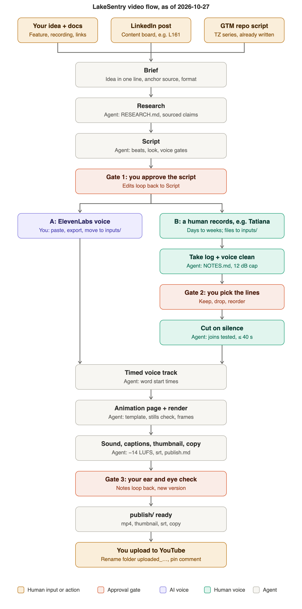

# malina · scaling videos

A toolkit for making short-form and product videos repeatable: one brief in, a finished video out, with as few manual steps as possible. Built for LakeSentry first, structured so other products, brands and presenters can plug in.

## Current flow



Details: [current flows](docs/current-flows.md) · [stages, inputs, human vs agent](docs/stages-inputs-roles.md) · [where the requirements live](docs/requirements-index.md) · [step-by-step agent flow](docs/agent-flow.md)

## Layout

```
engine/                 brand-free code, same for every product
  render/               HTML page -> frames (Playwright) -> mp4; thumbnails; product screen recordings
  scripts/              transcribe, voice clean, cut on silence, join checks, captions, srt, sound mix
brands/<name>/          one folder per brand
  brand.json            colours, fonts, logo paths, safe zone, transcription vocabulary, spelling fixes
  style-guide.md        the brand's video rules and rejected ideas
  assets/               logo, sfx, safe-zone overlay
  templates/            starting pages (demo, teaser, thumbnails) and publish templates
templates/brief.md      the intake file every new video starts from
episodes/               one folder per video (media is git-ignored)
docs/                   flow maps and process docs
```

## Setup (macOS)

```bash
brew install ffmpeg whisper-cpp node python uv
mkdir -p ~/.cache/whisper && curl -L -o ~/.cache/whisper/ggml-base.en.bin https://huggingface.co/ggerganov/whisper.cpp/resolve/main/ggml-base.en.bin
cd engine/render && npm ci && npx playwright install chromium
```

Voice cleanup (DeepFilterNet), mlx-whisper and the face cutout run through `uvx` and download their models on first use.

## Using a brand

Scripts that need brand values read them from `BRAND`:

```bash
BRAND=brands/lakesentry/brand.json python3 engine/scripts/make_srt.py vertical voiceover.mp3 out.en.srt
```

Today `BRAND` drives the srt spelling fixes (`make_srt.py`), the transcription vocabulary (`transcribe_mlx.sh`) and the demo sign-in page (`record_screen.js`). Colours and fonts in `brand.json` are documented, but the HTML templates still have them inline.

## Adding a new brand

1. Copy `brands/lakesentry/` to `brands/<new>/`.
2. Replace the `brand.json` values, the logo files, and the safe-zone overlay if it differs.
3. Rewrite `style-guide.md` for the new brand: keep the structure, drop the LakeSentry decisions.
4. Re-skin the templates in `templates/`.

## Status and what is not ported yet

- **Ported:** the `_flow` HTML renderer and tools, the `_toolkit` voice and cut scripts, and the LakeSentry logo, sfx, safe zone, templates and style guide.
- **Not ported on purpose:** the old Remotion renderer (TZ3 to TZ8, 1.3 GB, licence free only for teams of three or fewer) and the two scripts that depend on it (`sfx_mix.sh`, `remap_cues.py`); `music_mix.py`, since music beds are off per the style rules; `scratch_vo.py`, since voiceovers come from ElevenLabs only.
- **Still LakeSentry-specific:** the HTML templates (colours and fonts inline) and `docs/agent-flow.md`. Existing episode folders reference `../../../_assets/brand/`; new episodes should point at `brands/<name>/assets/` instead.
- **Licences:** the sounds in `brands/lakesentry/assets/sfx/` come from Pixabay and Freesound. Check attribution terms before the repo goes public.

## Working in this repo

Commit to a branch and open a pull request rather than pushing to `main`.
