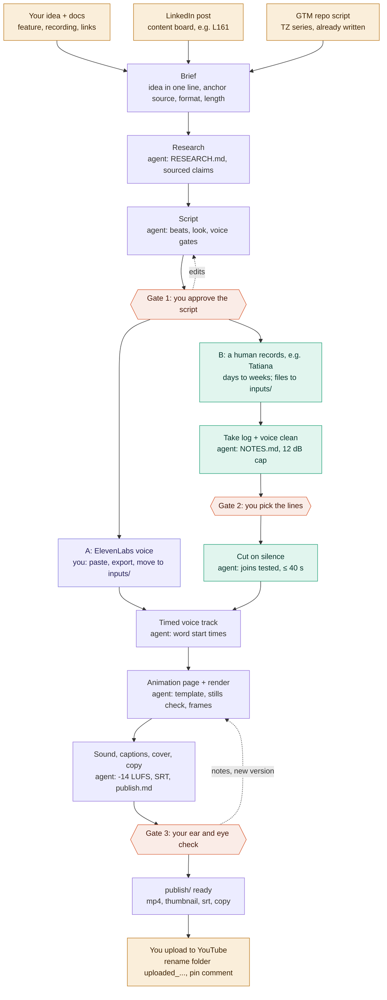

# Video flow map (as of 2026-10-27)

Amber = human input or action. Coral = approval gate. Purple = AI voice lane. Teal = human voice lane. Grey = agent work.

## How topics arrive

Every video starts from one anchor source. So far there have been three kinds:

1. **Your idea plus material.** A feature name, a screen recording, doc links. Used for the product demos (calculator, AI services, MCP server, Genie).
2. **A LinkedIn post from the content board.** The post is the brief and the blog it links to is the source. Used for the 2026-10-21 Shorts scripts (L161, L166, L167).
3. **A script already written in the GTM repo** (`content/videos/short form/`). Used for the TZ talking-head series. The repo copy stays the authority for the words.

The `Brief` step normalises all three into one file: see `templates/brief.md`.

## Where the time goes

- Lane B waits on filming between Gate 1 and the take log. Files sometimes arrive truncated.
- Gate 3 is the longest loop: 4 to 13 versions per video so far.
- Two toolkits coexist in the source folder: the older Remotion pipeline (`_toolkit`, TZ3 to TZ8) and the HTML renderer (`_flow`, everything since October 2026). Lane B still borrows `isolate.sh` and the join checks from the old one.

See `stages-inputs-roles.md` for every stage's inputs and who does what.
