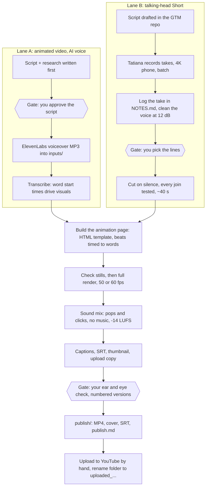

# Current video flows (as of 2026-10-27)

Two entry lanes, one shared back half. Coral boxes are manual gates that wait on a human.

## Where the time goes

- Lane B has a scheduling gap between "script drafted" and "takes recorded" that no tool controls. Files sometimes arrive truncated.
- The ear-check gate is the longest loop: 4 to 13 versions per video so far.
- Two toolkits coexist in the source folder: the older Remotion pipeline (`_toolkit`, TZ3 to TZ8) and the HTML renderer (`_flow`, everything since October 2026). Lane B still borrows `isolate.sh` and the join checks from the old one.
